# Android 앱 실제 실행 스크린샷

촬영일: 2026-10-21 (한국시간) · 앱 `0.3.1-demo` · 소스 `a09fde5`

Android 8.0(API 26) x86_64 에뮬레이터에서 기존 APK를 설치하고 실행한 화면입니다. 해상도는 1280×960, 밀도는 160dpi입니다. 모든 PNG는 `adb exec-out screencap -p`로 저장한 원본이며, 합성·목업·생성 이미지가 아닙니다. 실제 태블릿 모델에서 촬영한 사진은 아닙니다.

Node.js 테스트 서버에 연결해 아메리카노 1개(4,500원)와 크루아상 1개(4,000원)를 선택했습니다. 8,500코인 승인 시 혜택 5,000·유료 3,500코인 차감, 전체 취소 후 초기 잔액(유료 100,000·혜택 5,000) 복원을 확인했습니다. 테스트 전용 DB를 사용했으며 실제 금전 거래는 없습니다.

장바구니 캡처는 같은 주문 화면을 아래로 스크롤한 상태입니다. 관리 메뉴·홈·장비 화면은 상단 이음페이 로고를 길게 눌러 진입했습니다. 결제 대기/결과 불명(T06) 장애 재현 화면은 이번 캡처에 포함하지 않았습니다. 외부 결제·실제 고객 인증·실단말 검수는 여전히 미완료입니다.

## 화면 목록

| 화면 | 설명 |
|---|---|
| [단말 등록](01-registration.png) | T01 |
| [주문 시작](02-welcome.png) | 시작 화면 |
| [상품 메뉴 선택](03-menu.png) | T04 |
| [장바구니·합계](04-cart.png) | T04 |
| [결제수단 선택](05-payment-methods.png) | T05 |
| [코인 테스트 승인 확인](06-payment-confirmation.png) | 확인창 |
| [결제 완료·명세](07-payment-result.png) | T07 |
| [승인 거래 내역](08-history.png) | T08 |
| [전체 취소·사유 입력](09-cancellation.png) | T09 |
| [취소 완료 내역](10-cancelled-history.png) | T08 |
| [로고 길게 누르기 관리 메뉴](11-management-menu.png) | 관리 메뉴 |
| [거래 현황 홈](12-home.png) | T03 |
| [장비·앱 상태](13-device.png) | T10 |

## 단말 등록

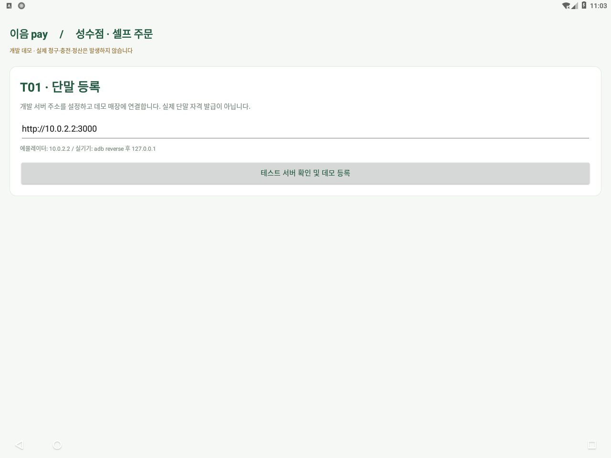

## 주문 시작

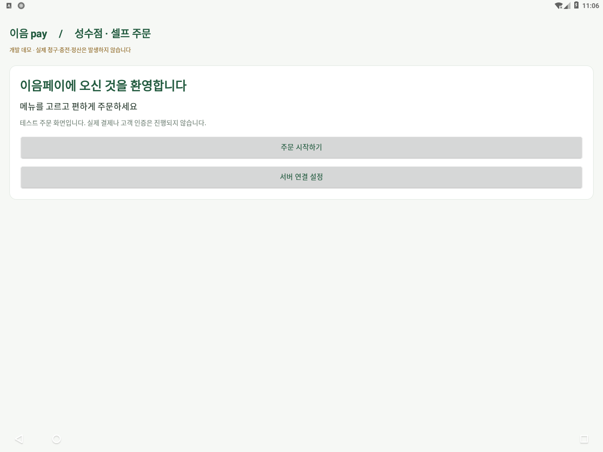

## 상품 메뉴 선택

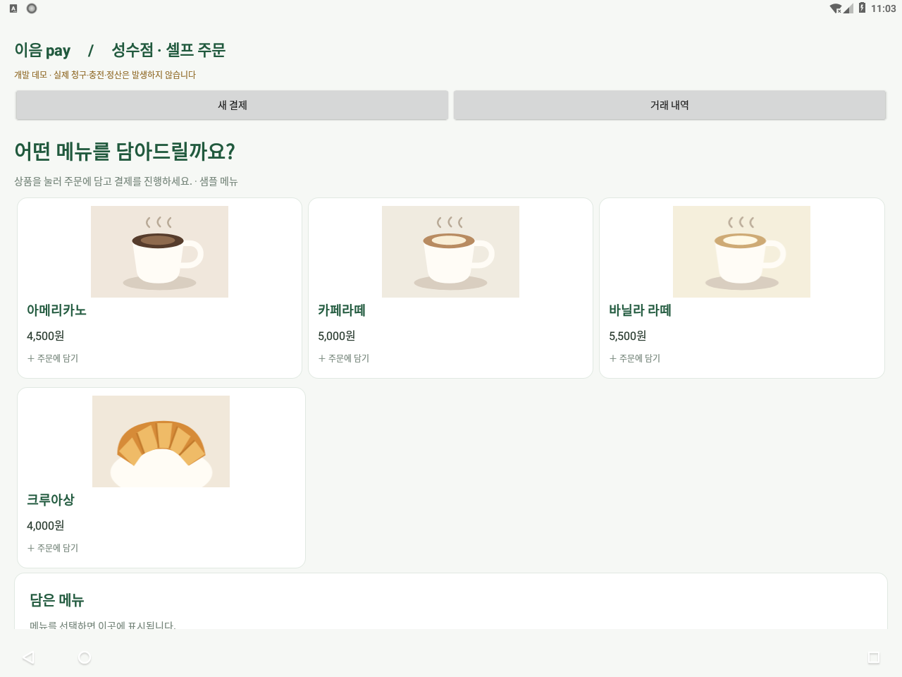

## 장바구니·합계

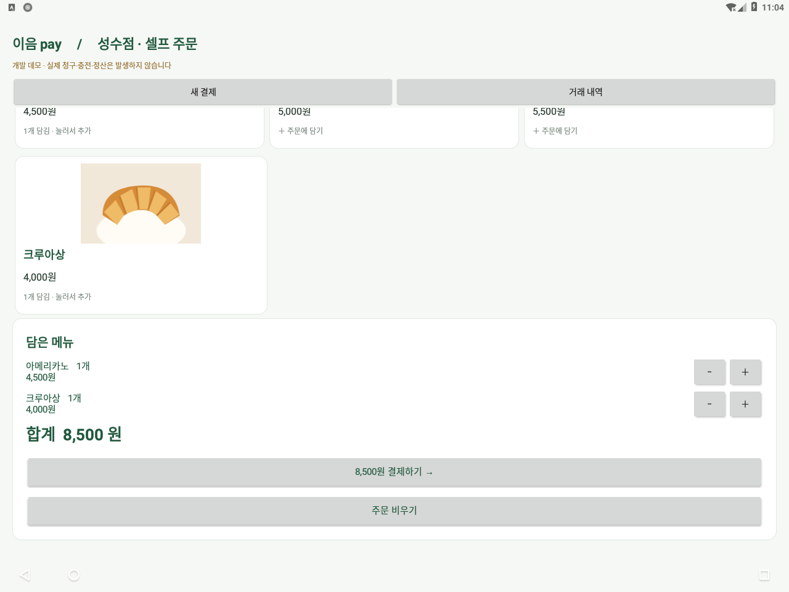

## 결제수단 선택

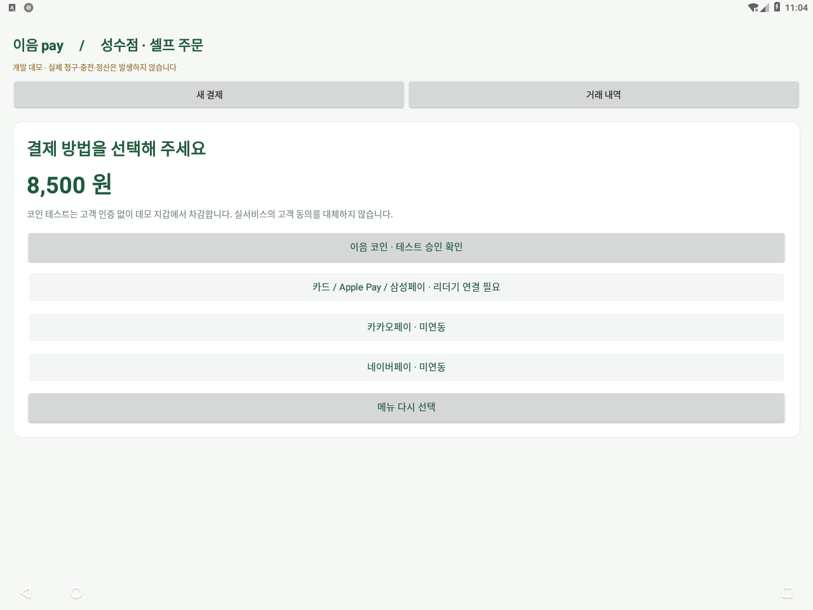

## 코인 테스트 승인 확인

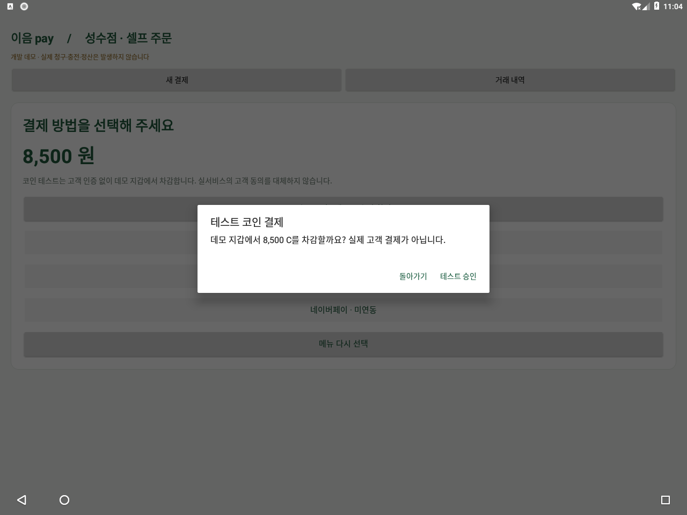

## 결제 완료·명세

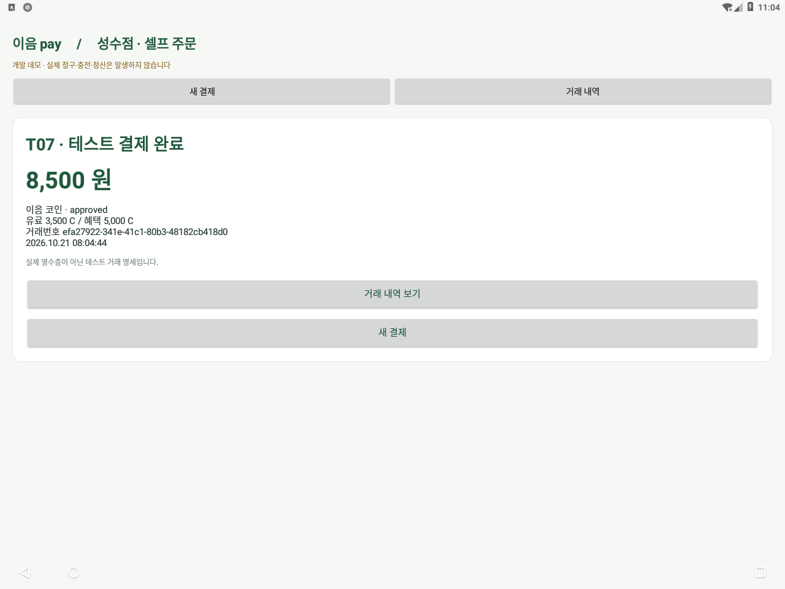

## 승인 거래 내역

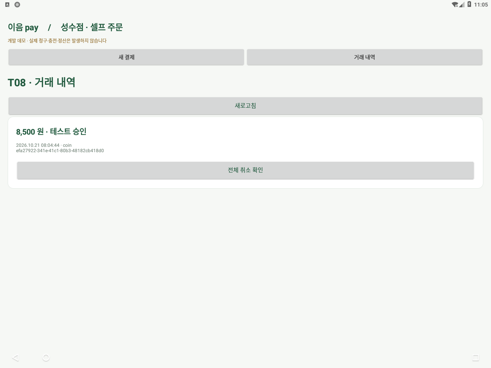

## 전체 취소·사유 입력

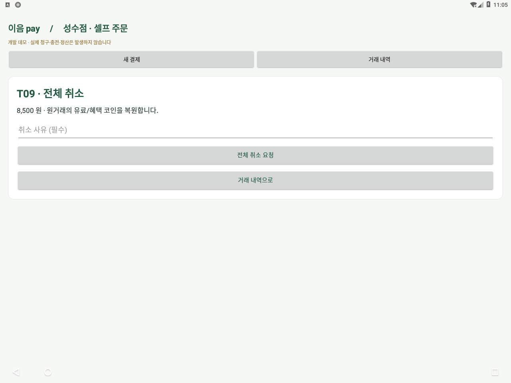

## 취소 완료 내역

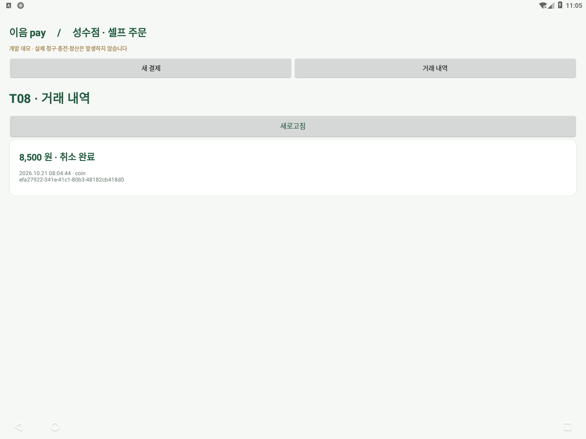

## 로고 길게 누르기 관리 메뉴

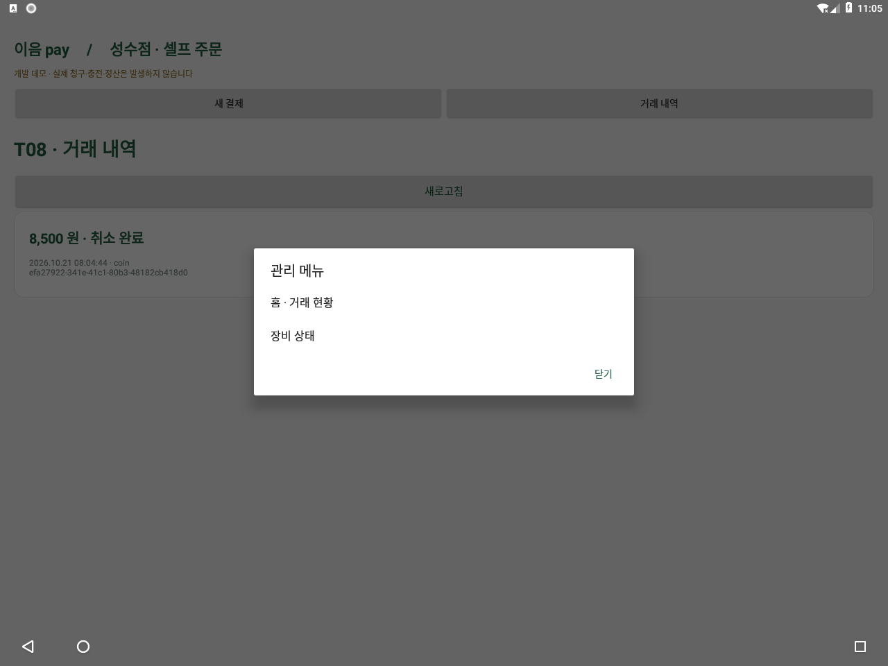

## 거래 현황 홈

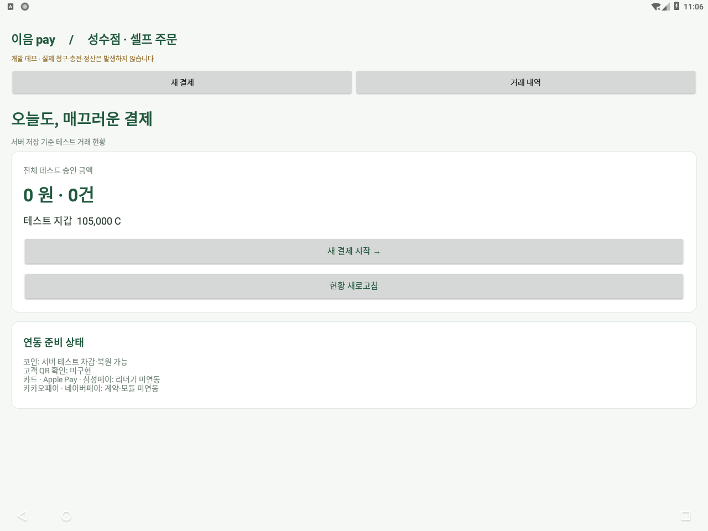

## 장비·앱 상태

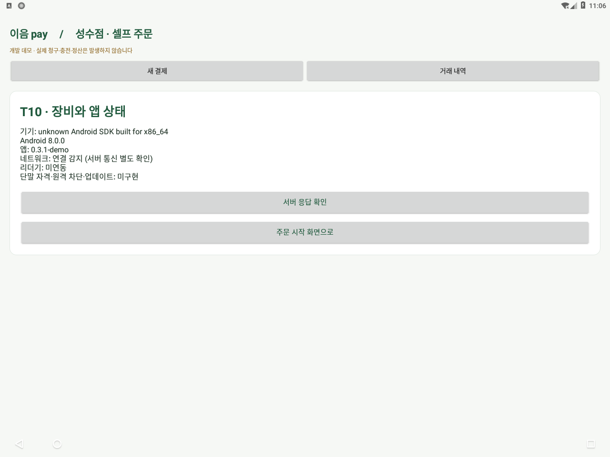

## 실기기에서 다시 캡처하기

원하는 화면을 연 뒤 Mac 터미널에서 다음 명령을 실행합니다. 태블릿의 USB 디버깅 연결이 필요합니다. 여러 기기가 연결돼 있다면 `adb -s 기기번호`로 대상을 지정하세요.

```bash
"$HOME/Library/Android/sdk/platform-tools/adb" exec-out screencap -p > screen.png
```
